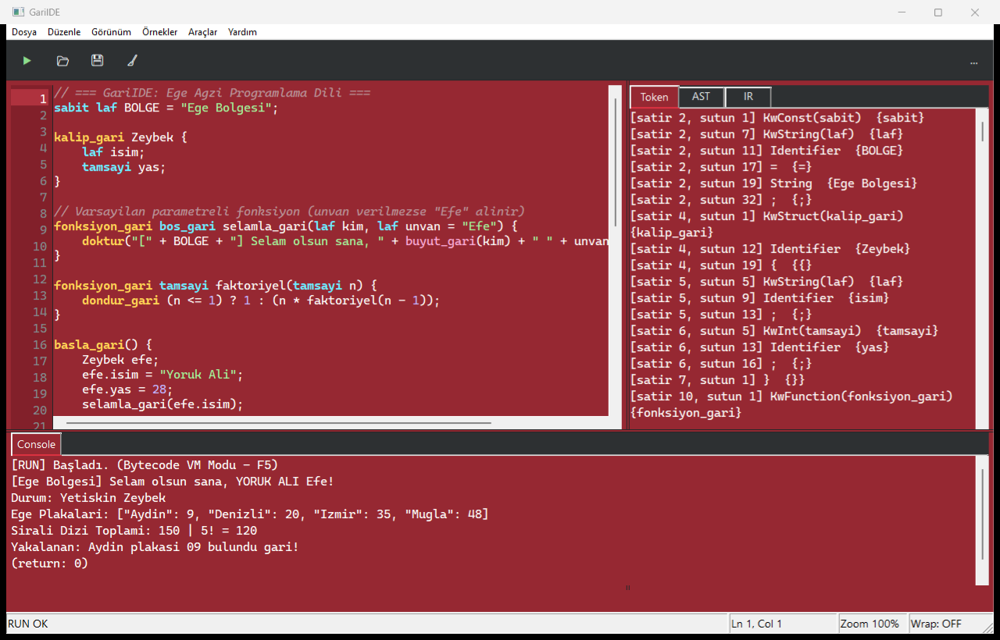
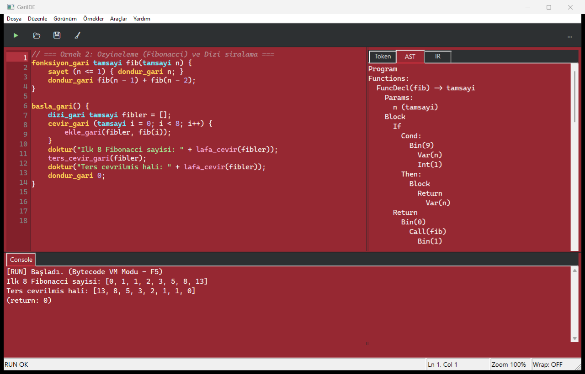
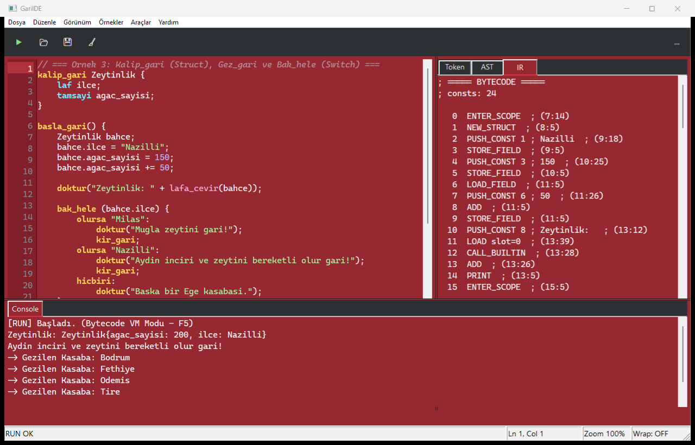
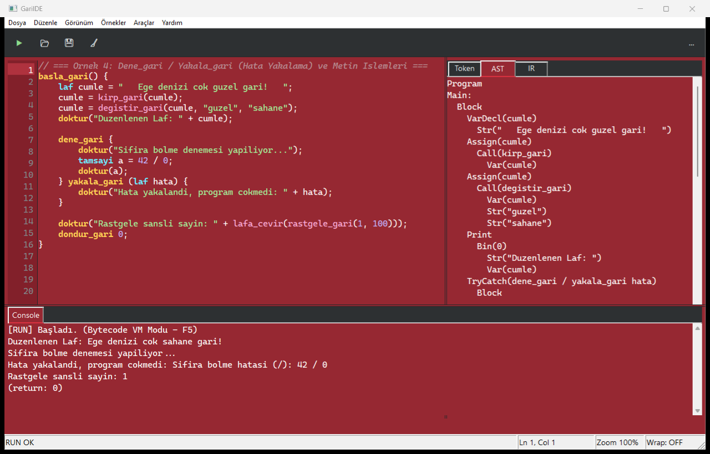

# GariIDE — Aegean-Turkish Dialect Programming Language, Compiler & Bytecode VM

<div align="center">


**🌐 Language / Dil Seçimi:** [**Türkçe (README.md)**](./README.md) | **English**

*A statically type-checked programming language inspired by the Aegean-Turkish regional dialect ("Ege Ağzı"), featuring a custom Bytecode Virtual Machine (VM), an AST Tree-Walk Interpreter, and a native Win32 Integrated Development Environment (IDE).*

</div>

---

## 📸 Screenshots

### 1. IDE Overview, Live Syntax Highlighting & Tokenizer Inspector


### 2. Recursive Functions & Abstract Syntax Tree (AST) Inspector


### 3. Structs (`kalip_gari`), `bak_hele` (Switch-Case) & Bytecode IR Disassembly


### 4. Exception Handling (`dene_gari / yakala_gari`) & String Manipulation


---

## ✨ Key Features

### 🧠 Dual Execution Engine & Compiler Pipeline
- **Lexical Analyzer (Lexer):** Tokenizes Aegean-Turkish keywords, string escape sequences (`\n`, `\t`, `\"`), single/multi-line comments (`//`, `/* ... */`), and compound operators (`+=`, `-=`, `*=`, `/=`, `%=`, `++`, `--`, `?:`).
- **Recursive-Descent Parser (AST):** Parses source code into a strongly-structured Abstract Syntax Tree with real-time visualization in the right inspector pane.
- **Static Type Checker:** Validates variable declarations, arrays, dictionaries (`sozluk_gari`), structs (`kalip_gari`), and function signatures (including default parameters and `bos_gari`/`void` return rules) before execution.
- **Bytecode Compiler & Stack-Based Virtual Machine (VM):** Compiles the AST into custom bytecode instructions (`PUSH_CONST`, `LOAD`, `STORE`, `NEW_ARRAY_LIST`, `NEW_MAP`, `NEW_STRUCT`, `TRY_BEGIN`, `CALL_BUILTIN`, etc.) and executes them on a fast stack VM (`F5`).
- **AST Tree-Walk Interpreter:** Provides a secondary execution mode directly over the AST (`Ctrl+F5`).

### 🎨 Modern "Dark Carbon & Crimson Pro" Native Win32 IDE
- **Live Syntax Highlighting:** High-contrast color palette for dialect keywords, data types, built-in functions, strings, numbers, and comments.
- **Smart Editor Assistance:**
  - **Inline Auto-Complete** via `Ctrl+Space`
  - **Smart Auto-Indentation** on `Enter` and `}`
  - **Visual Error Squiggle / Underline** jumping directly to the offending line and column on compile or runtime errors
- **Compiler Inspector Tabs (Right Panel):** Switch seamlessly between **Token**, **AST**, and **IR (Bytecode)** views.
- **Interactive Console (Bottom Panel):** Displays `doktur()` output and handles asynchronous blocking user input (`oku_gari()`, `oku_tamsayi()`, `oku_hassas_sayi()`).

---

## 📖 Language Reference (Aegean Dialect -> Standard Mapping)

### 1. Keywords & Control Flow

| Gari Keyword | Standard Equivalent (C / C++) | Description |
| :--- | :--- | :--- |
| `basla_gari() { ... }` | `int main() { ... }` | Main program entry point |
| `fonksiyon_gari` | `function` | Function declaration keyword |
| `dondur_gari <expr>;` | `return <expr>;` | Return a value from a function |
| `kalip_gari <Name> { ... }` | `struct <Name> { ... }` | Custom composite data structure (`struct`) |
| `doktur(<expr>);` | `print(<expr>);` | Print output to the IDE console |
| `sayet (...) { ... } yoksa { ... }` | `if (...) { ... } else { ... }` | Conditional branching (supports `yoksa sayet`) |
| `bak_hele (x) { olursa 1: ... hicbiri: ... }` | `switch (x) { case 1: ... default: ... }` | Switch-case control structure |
| `oldukca (...) { ... }` | `while (...) { ... }` | While loop |
| `bi_yap_hele { ... } oldukca (...);` | `do { ... } while (...);` | Do-while loop |
| `cevir_gari (init; cond; step) { ... }` | `for (init; cond; step) { ... }` | C-style for loop |
| `gez_gari (<type> x : collection) { ... }` | `for (<type> x : collection)` | Foreach loop over arrays, maps, or strings |
| `kir_gari;` / `pas_gec;` | `break;` / `continue;` | Loop control statements |
| `dene_gari { ... } yakala_gari (laf e) { ... }` | `try { ... } catch (string e) { ... }` | Exception handling block |
| `firlat_gari("Message");` | `throw "Message";` | Throw a custom runtime exception |
| `hem_de` / `ya_da` / `degil_gari` | `&&` / `\|\|` / `!` | Logical AND, OR, NOT operators |

### 2. Data Types

| Gari Type | Equivalent | Example Declaration |
| :--- | :--- | :--- |
| `tamsayi` | `int` | `tamsayi age = 28;` |
| `hassas_sayi` | `float` | `hassas_sayi ratio = 3.14;` |
| `cift_hassas_sayi` | `double` | `cift_hassas_sayi pi = pi_sayisi();` |
| `laf` | `string` | `laf greeting = "Merhaba Efe!";` |
| `mantik` (`hakli` / `haksiz`) | `bool` (`true` / `false`) | `mantik active = hakli;` |
| `bos_gari` | `void` | `fonksiyon_gari bos_gari log(laf s) { ... }` |
| `sabit` | `const` | `sabit laf REGION = "Aegean";` |
| `dizi_gari <type>` | `vector<T>` / `Array` | `dizi_gari tamsayi arr = [10, 20, 30];` |
| `sozluk_gari <type>` | `map<string, T>` / `Dict` | `sozluk_gari tamsayi codes = ["Aydin": 9, "Izmir": 35];` |

### 3. Standard Built-in Functions

- **I/O:** `doktur(x)`, `oku_gari()`, `oku_tamsayi()`, `oku_hassas_sayi()`
- **Arrays & Maps:** `boyut_gari(x)`, `ekle_gari(arr, item)`, `cikar_gari(arr)`, `sirala_gari(arr)`, `ters_cevir_gari(x)`, `icinde_var_mi(src, target)`, `anahtarlar_gari(map)`, `sil_gari(map, key)`
- **String (`laf`) Utilities:** `buyut_gari(s)`, `kucult_gari(s)`, `kirp_gari(s)`, `parcala_gari(s, start, length)`, `degistir_gari(s, old, new)`
- **Type Conversions:** `lafa_cevir(x)`, `tamsayiya_cevir(x)`, `hassasa_cevir(x)`
- **Mathematics:** `kok(x)`, `us(a, b)`, `mutlak(x)`, `taban(x)`, `tavan(x)`, `yuvarla(x)`, `min_gari(a, b)`, `max_gari(a, b)`, `sinus(deg)`, `kosinus(deg)`, `tanjant(deg)`, `cotanjant(deg)`, `ln(x)`, `log10(x)`, `ustel(x)`, `pi_sayisi()`, `e_sayisi()`, `rastgele_gari(min, max)`
- **File I/O & System:** `dosya_yaz_gari(path, content)`, `dosya_oku_gari(path)`, `dosya_var_mi(path)`, `bekle_gari(ms)`, `vakit_gari()`

---

## 💻 Code Example (`demo.gari`)

```gari
sabit laf BOLGE = "Ege Bolgesi";

kalip_gari Zeybek {
    laf isim;
    tamsayi yas;
}

fonksiyon_gari bos_gari selamla_gari(laf kim, laf unvan = "Efe") {
    doktur("[" + BOLGE + "] Selam olsun sana, " + buyut_gari(kim) + " " + unvan + "!");
}

fonksiyon_gari tamsayi faktoriyel(tamsayi n) {
    dondur_gari (n <= 1) ? 1 : (n * faktoriyel(n - 1));
}

basla_gari() {
    Zeybek efe;
    efe.isim = "Yoruk Ali";
    efe.yas = 28;
    selamla_gari(efe.isim);

    laf durum = (efe.yas >= 18) ? "Yetiskin Zeybek" : "Genc Kizan";
    doktur("Durum: " + durum);

    sozluk_gari tamsayi plakalar = ["Aydin": 9, "Izmir": 35, "Mugla": 48];
    plakalar["Denizli"] = 20;
    doktur("Ege Plakalari: " + lafa_cevir(plakalar));

    dizi_gari tamsayi sayilar = [30, 10, 40, 20];
    ekle_gari(sayilar, 50);
    sirala_gari(sayilar);

    tamsayi toplam = 0;
    gez_gari (tamsayi s : sayilar) {
        toplam += s;
    }
    doktur("Sirali Dizi Toplami: " + lafa_cevir(toplam) + " | 5! = " + lafa_cevir(faktoriyel(5)));

    dene_gari {
        sayet (icinde_var_mi(plakalar, "Aydin") hem_de hakli) {
            firlat_gari("Aydin plakasi 0" + lafa_cevir(plakalar["Aydin"]) + " bulundu gari!");
        }
    } yakala_gari (laf bilgi) {
        doktur("Yakalanan: " + bilgi);
    }

    dondur_gari 0;
}
```

---

## 🛠️ Building from Source

### Prerequisites
- **OS:** Windows 10 / 11 (x64)
- **Toolchain:** Visual Studio 2022 (MSVC v143, C++17) & Windows SDK

### Build via MSBuild CLI
```powershell
msbuild GariIDE.sln /p:Configuration=Release /p:Platform=x64
```
The standalone executable will be generated at `x64\Release\GariIDE.exe`.

---

## 👤 Author

- **Yusuf Koç** — [GitHub (@YusufKoc05)](https://github.com/YusufKoc05)
