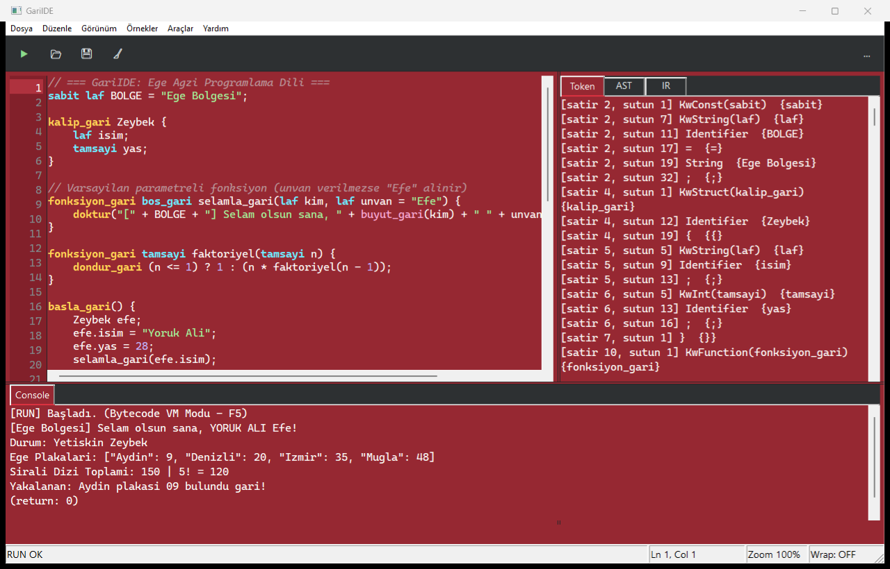
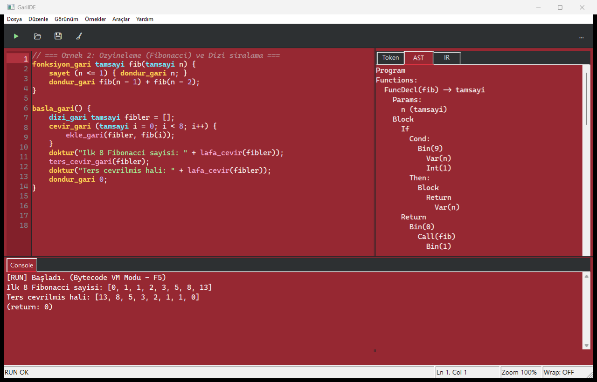
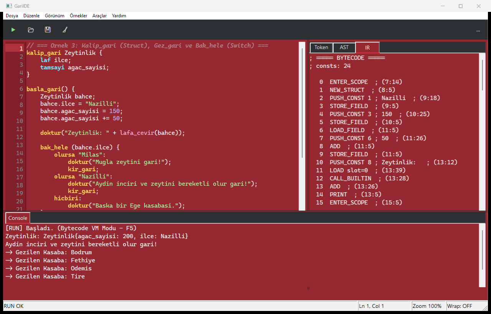
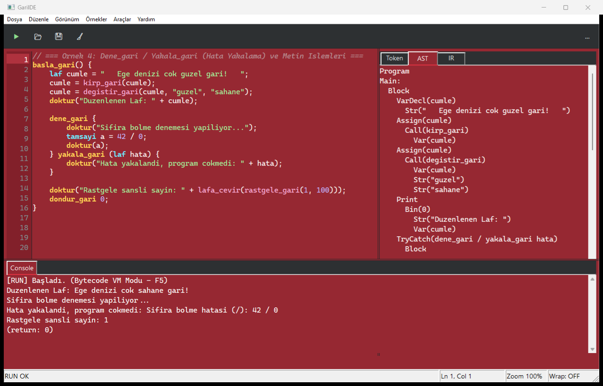

# GariIDE — Ege Ağzı Programlama Dili, Derleyici ve Sanal Makine (VM)

<div align="center">


**🌐 Dil Seçimi / Language:** **Türkçe** | [**English (README.en.md)**](./README.en.md)

*Ege yöresi ağız özelliklerinden ilham alan, statik tip denetimli (Type-Checked), hem Bytecode Sanal Makine (VM) hem de Soyut Sözdizimi Ağacı (AST) yorumlayıcısına sahip özgün bir programlama dili ve tümleşik geliştirme ortamı (IDE).*

</div>

---

## 📸 Ekran Görüntüleri

### 1. Genel Görünüm, Canlı Sözdizimi Renklendirme & Token Çözümleyici


### 2. Özyinelemeli (Recursive) Fonksiyonlar & Soyut Sözdizimi Ağacı (AST)


### 3. Yapılar (`kalip_gari`), `bak_hele` (Switch-Case) & Bytecode IR Çıktısı


### 4. Hata Yakalama (`dene_gari / yakala_gari`) & Metin İşlemleri


---

## ✨ Öne Çıkan Özellikler

### 🧠 Çift Çalıştırma Motoru ve Derleyici Mimarisi
- **Sözcük Çözümleyici (Lexer):** Ege ağzı anahtar kelimeleri, kaçış karakterlerini (`\n`, `\t`, `\"`), tek/çok satırlı yorumları (`//`, `/* ... */`) ve bileşik operatörleri (`+=`, `-=`, `*=`, `/=`, `%=`, `++`, `--`, `?:`) ayrıştırır.
- **Recursive-Descent Parser (AST):** Kaynak kodu hiyerarşik bir Soyut Sözdizimi Ağacına dönüştürür ve sağ panelde canlı olarak görselleştirir.
- **Statik Tip Denetleyici (TypeChecker):** Çalıştırma öncesinde değişken, dizi, sözlük, yapı (`kalip_gari`) alanları ve fonksiyon parametre/dönüş tiplerini (`bos_gari` dahil) denetler.
- **Bytecode Derleyici & Yığın Tabanlı Sanal Makine (Stack VM):** AST'yi özel Bytecode komutlarına (`PUSH_CONST`, `LOAD`, `STORE`, `NEW_ARRAY_LIST`, `NEW_MAP`, `NEW_STRUCT`, `TRY_BEGIN`, `CALL_BUILTIN` vb.) derleyerek yüksek hızda çalıştırır (`F5`).
- **AST Yorumlayıcı (Tree-Walk Interpreter):** İkinci bir doğrulama motoru olarak kodu doğrudan ağaç üzerinden çalıştırır (`Ctrl+F5`).

### 🎨 Modern "Dark Carbon & Crimson Pro" Win32 IDE
- **Canlı Sözdizimi Renklendirme (Syntax Highlighting):** Anahtar kelimeler, veri tipleri, yerleşik fonksiyonlar, metinler, sayılar ve yorum satırları için yüksek kontrastlı renk paleti.
- **Akıllı Kodlama Desteği:**
  - `Ctrl+Space` ile **Satır İçi Otomatik Tamamlama (Auto-Complete)**
  - `Enter` ve `}` tuşlarıyla **Otomatik Girintileme (Auto-Indent)**
  - İlk hatada satır/sütun konumunu **altın sarısı dalgalı çizgiyle (Error Highlight)** işaretleme
- **Canlı Derleyici İnceleme Panelleri (Sağ Panel):** Tek tıkla **Token**, **AST** ve **IR (Bytecode)** çıktılarını inceleme.
- **Etkileşimli Konsol (Alt Panel):** `doktur()` çıktıları ve `oku_gari()`, `oku_tamsayi()`, `oku_hassas_sayi()` ile eşzamanlı kullanıcı girdisi kuyruğu.

---

## 📖 Ege Ağzı Dil Sözlüğü (Sözdizimi Rehberi)

### 1. Anahtar Kelimeler ve Kontrol Yapıları

| Ege Ağzı Anahtar Kelime | Standart Karşılığı (C / C++) | Açıklama |
| :--- | :--- | :--- |
| `basla_gari() { ... }` | `int main() { ... }` | Programın ana giriş noktası |
| `fonksiyon_gari` | `function` | Fonksiyon tanımlama bildirimi |
| `dondur_gari <ifade>;` | `return <expr>;` | Fonksiyondan değer döndürme |
| `kalip_gari <Ad> { ... }` | `struct <Name> { ... }` | Özel veri yapısı / nesne kalıbı tanımlama |
| `doktur(<ifade>);` | `print(<expr>);` | Konsola satır yazdırma |
| `sayet (...) { ... } yoksa { ... }` | `if (...) { ... } else { ... }` | Koşullu dallanma (`yoksa sayet` destekli) |
| `bak_hele (x) { olursa 1: ... hicbiri: ... }` | `switch (x) { case 1: ... default: ... }` | Çoklu durum seçimi |
| `oldukca (...) { ... }` | `while (...) { ... }` | Koşullu döngü |
| `bi_yap_hele { ... } oldukca (...);` | `do { ... } while (...);` | En az bir kez çalışan döngü |
| `cevir_gari (init; kosul; adim) { ... }` | `for (init; cond; step) { ... }` | Sayısal döngü |
| `gez_gari (<tip> x : koleksiyon) { ... }` | `for (<type> x : collection)` | Dizi, sözlük veya metin üzerinde gezinme (`foreach`) |
| `kir_gari;` / `pas_gec;` | `break;` / `continue;` | Döngüyü sonlandırma veya sonraki adıma geçme |
| `dene_gari { ... } yakala_gari (laf h) { ... }` | `try { ... } catch (string e) { ... }` | Çalışma zamanı hata yakalama |
| `firlat_gari("Mesaj");` | `throw "Message";` | Özel çalışma zamanı hatası fırlatma |
| `hem_de` / `ya_da` / `degil_gari` | `&&` / `\|\|` / `!` | Mantıksal Ve, Veya, Değil operatörleri |

### 2. Veri Tipleri

| Ege Ağzı Tip | Karşılığı | Örnek Tanımlama |
| :--- | :--- | :--- |
| `tamsayi` | `int` | `tamsayi yas = 28;` |
| `hassas_sayi` | `float` | `hassas_sayi oran = 3.14;` |
| `cift_hassas_sayi` | `double` | `cift_hassas_sayi pi = pi_sayisi();` |
| `laf` | `string` | `laf selam = "Merhaba Efe!";` |
| `mantik` (`hakli` / `haksiz`) | `bool` (`true` / `false`) | `mantik aktif = hakli;` |
| `bos_gari` | `void` | `fonksiyon_gari bos_gari yaz(laf s) { ... }` |
| `sabit` | `const` | `sabit laf BOLGE = "Ege";` |
| `dizi_gari <tip>` | `vector<T>` / `Array` | `dizi_gari tamsayi d = [10, 20, 30];` |
| `sozluk_gari <tip>` | `map<string, T>` / `Dict` | `sozluk_gari tamsayi plaka = ["Aydin": 9, "Izmir": 35];` |

### 3. Yerleşik (Built-in) Fonksiyonlar

- **Girdi / Çıktı:** `doktur(x)`, `oku_gari()`, `oku_tamsayi()`, `oku_hassas_sayi()`
- **Dizi & Sözlük:** `boyut_gari(x)`, `ekle_gari(dizi, eleman)`, `cikar_gari(dizi)`, `sirala_gari(dizi)`, `ters_cevir_gari(x)`, `icinde_var_mi(kaynak, aranan)`, `anahtarlar_gari(sozluk)`, `sil_gari(sozluk, anahtar)`
- **Metin (`laf`) İşlemleri:** `buyut_gari(s)`, `kucult_gari(s)`, `kirp_gari(s)`, `parcala_gari(s, baslangic, uzunluk)`, `degistir_gari(s, eski, yeni)`
- **Tip Dönüşümleri:** `lafa_cevir(x)`, `tamsayiya_cevir(x)`, `hassasa_cevir(x)`
- **Matematik:** `kok(x)`, `us(a, b)`, `mutlak(x)`, `taban(x)`, `tavan(x)`, `yuvarla(x)`, `min_gari(a, b)`, `max_gari(a, b)`, `sinus(deg)`, `kosinus(deg)`, `tanjant(deg)`, `cotanjant(deg)`, `ln(x)`, `log10(x)`, `ustel(x)`, `pi_sayisi()`, `e_sayisi()`, `rastgele_gari(min, max)`
- **Dosya & Sistem:** `dosya_yaz_gari(yol, icerik)`, `dosya_oku_gari(yol)`, `dosya_var_mi(yol)`, `bekle_gari(ms)`, `vakit_gari()`

---

## 💻 Örnek Kod (`ornek.gari`)

```gari
sabit laf BOLGE = "Ege Bolgesi";

kalip_gari Zeybek {
    laf isim;
    tamsayi yas;
}

fonksiyon_gari bos_gari selamla_gari(laf kim, laf unvan = "Efe") {
    doktur("[" + BOLGE + "] Selam olsun sana, " + buyut_gari(kim) + " " + unvan + "!");
}

fonksiyon_gari tamsayi faktoriyel(tamsayi n) {
    dondur_gari (n <= 1) ? 1 : (n * faktoriyel(n - 1));
}

basla_gari() {
    Zeybek efe;
    efe.isim = "Yoruk Ali";
    efe.yas = 28;
    selamla_gari(efe.isim);

    laf durum = (efe.yas >= 18) ? "Yetiskin Zeybek" : "Genc Kizan";
    doktur("Durum: " + durum);

    sozluk_gari tamsayi plakalar = ["Aydin": 9, "Izmir": 35, "Mugla": 48];
    plakalar["Denizli"] = 20;
    doktur("Ege Plakalari: " + lafa_cevir(plakalar));

    dizi_gari tamsayi sayilar = [30, 10, 40, 20];
    ekle_gari(sayilar, 50);
    sirala_gari(sayilar);

    tamsayi toplam = 0;
    gez_gari (tamsayi s : sayilar) {
        toplam += s;
    }
    doktur("Sirali Dizi Toplami: " + lafa_cevir(toplam) + " | 5! = " + lafa_cevir(faktoriyel(5)));

    dene_gari {
        sayet (icinde_var_mi(plakalar, "Aydin") hem_de hakli) {
            firlat_gari("Aydin plakasi 0" + lafa_cevir(plakalar["Aydin"]) + " bulundu gari!");
        }
    } yakala_gari (laf bilgi) {
        doktur("Yakalanan: " + bilgi);
    }

    dondur_gari 0;
}
```

---

## 🛠️ Kurulum ve Derleme

### Gereksinimler
- **İşletim Sistemi:** Windows 10 / 11 (x64)
- **Derleyici:** Visual Studio 2022 (MSVC v143, C++17) ve Windows SDK

### Komut Satırından (MSBuild ile) Derleme
```powershell
msbuild GariIDE.sln /p:Configuration=Release /p:Platform=x64
```
Derleme tamamlandığında çalıştırılabilir dosya `x64\Release\GariIDE.exe` konumunda oluşturulur. Herhangi bir harici bağımlılık gerektirmeden doğrudan çalıştırılabilir.

---

## 📂 Proje Dosya Yapısı

```text
GariIDE/
├── GariIDE/
│   ├── lexer.h / lexer.cpp             # Sözcük Çözümleyici (Tokenizer)
│   ├── ast.h / ast.cpp                 # Soyut Sözdizimi Ağacı (AST) & Parser
│   ├── typechecker.h / typechecker.cpp # Statik Tip Denetleyici (Type Checker)
│   ├── value.h / value.cpp             # Değer Tipleri & Yerleşik (Built-in) Fonksiyonlar
│   ├── vm.h / vm.cpp                   # Bytecode Derleyici, Sanal Makine (VM) & AST Yorumlayıcı
│   ├── core.h / core.cpp               # IDE - Derleyici Köprüsü & Hata Raporlama
│   └── main.cpp                        # Win32 "Dark Carbon & Crimson" IDE Arayüzü
├── docs/screenshots/                   # Uygulama Ekran Görüntüleri
├── README.md                           # Türkçe Dokümantasyon
└── README.en.md                        # İngilizce Dokümantasyon (English Documentation)
```

---

## 👤 Geliştirici

- **Yusuf Koç** — [GitHub (@YusufKoc05)](https://github.com/YusufKoc05)
